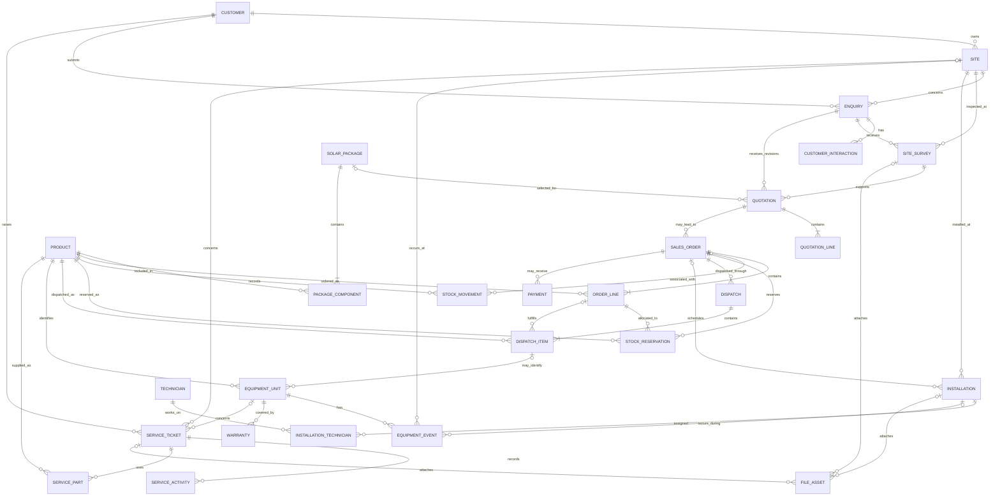

# 1. Final ER Diagram

**TEAM-APPROVED INITIAL DATABASE DESIGN – VERSION 1.0**  
Project: SolarVerse  
Status: Approved initial design for backend implementation  
Database: PostgreSQL  
Identifier convention: UUID primary keys

> This is the initial MVP design. Optional modules and detailed business policies must be implemented only within the rules below and coordinated with the team.

## Entity relationship diagram

## Cardinality and implementation notes

- Each `SITE` belongs to exactly one `CUSTOMER`; a customer may have multiple sites.
- For the MVP, every submitted enquiry creates a new customer and a new site. `ENQUIRY.customer_id` and `ENQUIRY.site_id` are required. Existing-customer/site selection is a later enhancement.
- Each enquiry belongs to one customer and one site. An enquiry can have multiple interactions, surveys and quotation revisions.
- Every quotation revision belongs to one enquiry and one survey. A quotation may optionally reference a configured package.
- A quotation contains one or more quotation lines; an order contains one or more order lines; a dispatch contains one or more dispatch items. The minimum-one-child rule must be validated by application/service logic and transaction handling; a normal foreign key alone does not enforce it.
- Each sales order references exactly one quotation. A quotation may lead to zero or more sales orders in this initial model. If the business later requires at most one order per quotation, add a unique constraint after team approval.
- Each payment references exactly one sales order. An order may have zero or more partial payments.
- `PACKAGE_COMPONENT` and `INSTALLATION_TECHNICIAN` are junction tables implementing many-to-many relationships.
- Optional references are nullable and shown with `o|` on the relevant parent endpoint. Required references are non-null and shown with `||`.
- File bytes are stored in Supabase Storage. `FILE_ASSET` stores metadata and the storage key only.
- Equipment serial numbers are nullable for products that do not require serial tracking. For serial-tracked products, require a serial number in backend validation; uniqueness applies to non-null serial numbers.
- `FILE_ASSET` may reference one parent only (survey, installation or service ticket). Enforce exactly one parent with a database check constraint.
- The diagram is conceptual. The schema and data dictionary define exact FK names, nullability and constraints.
