# SolarVerse ER Diagram — Database Design Version 1.2

**PROPOSED – PENDING TEAM APPROVAL**
Versions 1.0 and 1.1 are preserved in Git history at `f2b449c` and `307a14e`. This diagram represents the proposed PostgreSQL schema in `02-database-schema.md`; it is not a finalized business contract. Optional tables may be out of hackathon scope.

## Mermaid ER diagram

```mermaid
erDiagram
    CUSTOMER ||--o{ SITE : owns
    CUSTOMER ||--o{ ENQUIRY : submits
    SITE ||--o{ ENQUIRY : concerns
    ENQUIRY ||--o{ CUSTOMER_INTERACTION : has
    ENQUIRY ||--o{ ENQUIRY_STATUS_HISTORY : records
    ENQUIRY ||--o{ SITE_SURVEY : receives
    SITE ||--o{ SITE_SURVEY : inspected_at
    SITE_SURVEY ||--o{ SITE_SURVEY_REVIEW : has_review
    APP_USER ||--o{ SITE_SURVEY_REVIEW : reviews

    ENQUIRY ||--o{ QUOTATION : receives_revisions
    SITE_SURVEY ||--o{ QUOTATION : supports
    SOLAR_PACKAGE o|--o{ QUOTATION : selected_for
    QUOTATION ||--|{ QUOTATION_LINE : contains
    PRODUCT o|--o{ QUOTATION_LINE : quoted_as
    SOLAR_PACKAGE ||--o{ PACKAGE_COMPONENT : contains
    PRODUCT ||--o{ PACKAGE_COMPONENT : included_in

    QUOTATION ||--o{ SALES_ORDER : may_lead_to
    SALES_ORDER ||--|{ ORDER_LINE : contains
    QUOTATION_LINE o|--o{ ORDER_LINE : snapshot_source
    PRODUCT o|--o{ ORDER_LINE : ordered_as

    INVENTORY_LOCATION ||--o{ INVENTORY_BALANCE : holds
    PRODUCT ||--o{ INVENTORY_BALANCE : balanced_for
    INVENTORY_LOCATION ||--o{ STOCK_MOVEMENT : records
    PRODUCT ||--o{ STOCK_MOVEMENT : moves
    SALES_ORDER o|--o{ STOCK_MOVEMENT : associated_with
    INVENTORY_BALANCE ||--o{ STOCK_RESERVATION : allocates_from
    SALES_ORDER ||--o{ STOCK_RESERVATION : reserves
    ORDER_LINE ||--o{ STOCK_RESERVATION : allocated_to

    SALES_ORDER ||--o{ DISPATCH : dispatched_through
    DISPATCH ||--|{ DISPATCH_ITEM : contains
    ORDER_LINE o|--o{ DISPATCH_ITEM : fulfills
    PRODUCT ||--o{ DISPATCH_ITEM : dispatched_as
    PRODUCT ||--o{ EQUIPMENT_UNIT : identifies
    DISPATCH_ITEM o|--o{ EQUIPMENT_UNIT : identifies_unit
    EQUIPMENT_UNIT ||--o{ EQUIPMENT_EVENT : has_history
    SITE o|--o{ EQUIPMENT_EVENT : occurs_at
    INSTALLATION o|--o{ EQUIPMENT_EVENT : occurs_during
    EQUIPMENT_UNIT ||--o{ WARRANTY : covered_by

    SITE ||--o{ INSTALLATION : installed_at
    SALES_ORDER o|--o{ INSTALLATION : schedules
    INSTALLATION ||--o{ INSTALLATION_TECHNICIAN : assigned
    TECHNICIAN ||--o{ INSTALLATION_TECHNICIAN : works_on
    INSTALLATION ||--o{ INSTALLATION_CHECKLIST_ITEM : checklist

    CUSTOMER ||--o{ SERVICE_TICKET : raises
    SITE o|--o{ SERVICE_TICKET : concerns
    EQUIPMENT_UNIT o|--o{ SERVICE_TICKET : concerns
    SERVICE_TICKET ||--o{ SERVICE_TICKET_TECHNICIAN : assigned
    TECHNICIAN ||--o{ SERVICE_TICKET_TECHNICIAN : works_on
    SERVICE_TICKET ||--o{ SERVICE_ACTIVITY : records
    SERVICE_TICKET ||--o{ SERVICE_PART : uses
    PRODUCT ||--o{ SERVICE_PART : supplied_as

    SITE_SURVEY o|--o{ FILE_ASSET : attaches
    INSTALLATION o|--o{ FILE_ASSET : attaches
    SERVICE_TICKET o|--o{ FILE_ASSET : attaches

    SALES_ORDER ||--o{ PAYMENT : receives
    PAYMENT ||--o{ PAYMENT_REFUND : may_be_refunded_by

    CUSTOMER {
        uuid id PK
        varchar name
        varchar phone_e164
        varchar email
        timestamptz created_at
    }
    SITE {
        uuid id PK
        uuid customer_id FK
        varchar label
        text address_line
        varchar city
        varchar state
        varchar postal_code
        char country_code
        timestamptz created_at
    }
    ENQUIRY {
        uuid id PK
        uuid customer_id FK
        uuid site_id FK
        numeric requested_capacity_kw
        varchar requested_system_type
        numeric monthly_bill
        char monthly_bill_currency_code
        text requirements
        varchar status
        timestamptz created_at
    }
    CUSTOMER_INTERACTION {
        uuid id PK
        uuid enquiry_id FK
        varchar interaction_type
        text notes
        timestamptz occurred_at
        timestamptz created_at
    }
    ENQUIRY_STATUS_HISTORY {
        uuid id PK
        uuid enquiry_id FK
        varchar from_status
        varchar to_status
        timestamptz changed_at
        text reason
    }
    SITE_SURVEY {
        uuid id PK
        uuid enquiry_id FK
        uuid site_id FK
        timestamptz scheduled_at
        numeric roof_area_sqm
        varchar roof_direction
        numeric roof_tilt_degrees
        numeric shadow_free_area_sqm
        numeric monthly_bill
        char monthly_bill_currency_code
        numeric cable_distance_m
        boolean grid_suitability
        varchar status
        boolean is_current
        timestamptz submitted_at
        timestamptz approved_at
        timestamptz created_at
    }
    SITE_SURVEY_REVIEW {
        uuid id PK
        uuid survey_id FK
        uuid reviewer_id FK
        text reviewer_label
        varchar decision
        timestamptz reviewed_at
        text rejection_reason
        text notes
    }
    APP_USER {
        uuid id PK
        varchar display_name
        varchar email_normalized
        text password_hash
        varchar role
        boolean is_active
        timestamptz created_at
        timestamptz updated_at
    }
    SOLAR_PACKAGE {
        uuid id PK
        varchar name
        numeric capacity_kw
        varchar system_type
        boolean active
        timestamptz created_at
    }
    PRODUCT {
        uuid id PK
        varchar name
        varchar category
        boolean tracks_serial_number
        boolean active
        timestamptz created_at
    }
    PACKAGE_COMPONENT {
        uuid package_id PK, FK
        uuid product_id PK, FK
        numeric quantity
    }
    QUOTATION {
        uuid id PK
        uuid enquiry_id FK
        uuid survey_id FK
        uuid package_id FK
        integer version
        varchar status
        timestamptz created_at
        date valid_until
        char currency_code
        numeric subtotal_amount
        numeric discount_amount
        numeric tax_amount
        numeric total_amount
    }
    QUOTATION_LINE {
        uuid id PK
        uuid quotation_id FK
        uuid product_id FK
        text description_snapshot
        numeric quantity
        numeric unit_price
        numeric discount_amount
        numeric tax_amount
        numeric line_total
    }
    SALES_ORDER {
        uuid id PK
        uuid quotation_id FK
        varchar status
        timestamptz confirmed_at
        timestamptz created_at
        char currency_code
        numeric subtotal_amount
        numeric discount_amount
        numeric tax_amount
        numeric total_amount
    }
    ORDER_LINE {
        uuid id PK
        uuid order_id FK
        uuid source_quotation_line_id FK
        uuid product_id FK
        text description_snapshot
        numeric quantity
        numeric unit_price
        numeric discount_amount
        numeric tax_amount
        numeric line_total
    }
    INVENTORY_LOCATION {
        uuid id PK
        varchar name
        boolean active
        timestamptz created_at
    }
    INVENTORY_BALANCE {
        uuid location_id PK, FK
        uuid product_id PK, FK
        numeric quantity_on_hand
        timestamptz updated_at
    }
    STOCK_MOVEMENT {
        uuid id PK
        uuid location_id FK
        uuid product_id FK
        uuid order_id FK
        varchar movement_type
        numeric quantity_delta
        timestamptz occurred_at
        text notes
    }
    STOCK_RESERVATION {
        uuid id PK
        uuid location_id FK
        uuid order_id FK
        uuid order_line_id FK
        uuid product_id FK
        numeric quantity
        numeric quantity_consumed
        varchar status
        timestamptz created_at
        timestamptz released_at
    }
    DISPATCH {
        uuid id PK
        uuid order_id FK
        varchar status
        timestamptz dispatched_at
        timestamptz delivered_at
        varchar recipient_name
        text notes
        timestamptz created_at
    }
    DISPATCH_ITEM {
        uuid id PK
        uuid dispatch_id FK
        uuid order_id FK
        uuid order_line_id FK
        uuid product_id FK
        numeric quantity
    }
    EQUIPMENT_UNIT {
        uuid id PK
        uuid product_id FK
        uuid dispatch_item_id FK
        varchar serial_number
        timestamptz created_at
    }
    EQUIPMENT_EVENT {
        uuid id PK
        uuid equipment_unit_id FK
        uuid site_id FK
        uuid installation_id FK
        varchar event_type
        timestamptz occurred_at
        text notes
    }
    INSTALLATION {
        uuid id PK
        uuid order_id FK
        uuid site_id FK
        varchar status
        timestamptz scheduled_at
        timestamptz started_at
        timestamptz completed_at
        timestamptz customer_signed_off_at
        timestamptz created_at
    }
    TECHNICIAN {
        uuid id PK
        varchar name
        varchar phone_e164
        boolean active
        timestamptz created_at
    }
    INSTALLATION_TECHNICIAN {
        uuid installation_id PK, FK
        uuid technician_id PK, FK
        timestamptz assigned_at
    }
    INSTALLATION_CHECKLIST_ITEM {
        uuid id PK
        uuid installation_id FK
        varchar item_key
        text description_snapshot
        boolean is_completed
        timestamptz completed_at
        text notes
    }
    WARRANTY {
        uuid id PK
        uuid equipment_unit_id FK
        date starts_on
        date ends_on
        text terms
    }
    SERVICE_TICKET {
        uuid id PK
        uuid customer_id FK
        uuid site_id FK
        uuid equipment_unit_id FK
        varchar status
        timestamptz opened_at
        timestamptz closed_at
    }
    SERVICE_TICKET_TECHNICIAN {
        uuid ticket_id PK, FK
        uuid technician_id PK, FK
        timestamptz assigned_at
    }
    SERVICE_ACTIVITY {
        uuid id PK
        uuid ticket_id FK
        varchar activity_type
        varchar from_status
        varchar to_status
        timestamptz occurred_at
        text notes
    }
    SERVICE_PART {
        uuid id PK
        uuid ticket_id FK
        uuid product_id FK
        numeric quantity
    }
    FILE_ASSET {
        uuid id PK
        uuid site_survey_id FK
        uuid installation_id FK
        uuid service_ticket_id FK
        varchar bucket_name
        text storage_key
        varchar original_name
        varchar content_type
        bigint size_bytes
        char checksum_sha256
        timestamptz uploaded_at
    }
    PAYMENT {
        uuid id PK
        uuid order_id FK
        numeric amount
        char currency_code
        varchar status
        timestamptz paid_at
        varchar external_reference
        timestamptz created_at
    }
    PAYMENT_REFUND {
        uuid id PK
        uuid payment_id FK
        numeric amount
        varchar status
        text reason
        varchar external_reference
        timestamptz refunded_at
        timestamptz created_at
    }
```

## Notes and unresolved cardinalities

- `ENQUIRY` keeps the eight existing statuses: `new`, `contacted`, `survey_pending`, `qualified`, `quoted`, `converted`, `lost`, `cancelled`.
- `SITE` has `UNIQUE(customer_id, id)`; `ENQUIRY(customer_id, site_id)` references it in that order. `ENQUIRY(id, site_id)` is unique so `SITE_SURVEY(enquiry_id, site_id)` can reference the matching enquiry/site pair.
- `CUSTOMER_INTERACTION.interaction_type` is limited to `call`, `email`, `visit`, `note`, `whatsapp`, or `sms`.
- `SITE_SURVEY.status` is limited to `draft`, `submitted`, `approved`, or `rejected`. `is_current` can be true only when approved, and a partial unique index permits at most one current approved survey per enquiry. Earlier approved surveys remain as records with `is_current = false`.
- `SITE_SURVEY_REVIEW.reviewer_id` references `APP_USER` with `ON DELETE RESTRICT`; `reviewer_label` snapshots the reviewer's display name. Each approval/rejection is retained in its own review row.
- All UUID primary keys are generated in Python with `uuid.uuid4()`; the DDL has no UUID-generation defaults.
- A quotation revision is a separate `QUOTATION` row, unique by (`enquiry_id`, `version`), with its own lines and historical prices.
- Every order references one quotation; a quotation can currently lead to multiple orders because no unique constraint on `sales_order.quotation_id` is proposed.
- Every payment references one order; each payment may have zero or more refund records. Refund totals must be checked transactionally against captured payment totals.
- Mermaid uses `|{` for quotation/order/dispatch rows expected to contain at least one line/item. A foreign key alone does not enforce that parent-side minimum; the API/service must prevent sending/accepting an empty quotation or confirming an empty order/dispatch.
- `PACKAGE_COMPONENT`, `INVENTORY_BALANCE`, `INSTALLATION_TECHNICIAN`, and `SERVICE_TICKET_TECHNICIAN` are composite-key/link tables.
- `FILE_ASSET` has three nullable parent FKs but a check requires exactly one to be populated.
- `dispatch.delivered_at` represents delivery completion for the dispatch. Partial deliveries at different times are not fully represented; see unresolved decisions.
- The database schema file is authoritative for exact types, nullability, named constraints, and indexes. This diagram must be updated alongside any approved schema change.
- `APP_USER` provides normalized unique email, a password hash, role, active state, and timestamps. Deactivate accounts; historical review references prevent user deletion.

## Review areas represented

Financial snapshots; dispatch/delivery and warranty dates; inventory balance/reservation concurrency; installation checklist items; enquiry/status history and service status events; payment refunds; quotation revisions; service-ticket technician assignments; composite cross-table integrity; product/serialized equipment; survey reviews; Supabase file metadata; PostgreSQL naming/types/index standards; and schema/dictionary synchronization are represented in the related documents.
